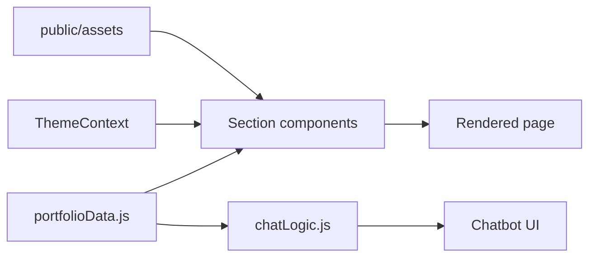

# Architecture

## Overview

A single-page portfolio built with React 18 (Create React App) and Tailwind CSS. It has no backend and no database. All content lives in one data file, and each section of the page is a component that reads from it.

| Layer | Choice |
|---|---|
| UI | React 18, function components, hooks |
| Styling | Tailwind CSS (`darkMode: "class"`), small custom CSS layer |
| State | Local `useState`, one React context for theme |
| Content | `src/data/portfolioData.js` |
| Chatbot | Rule-based matcher in `src/utils/chatLogic.js` |
| Hosting | Static build (`npm run build`), SPA redirect in `public/_redirects` |

## Folder structure

```
src/
  index.js                 Entry. Wraps App in ThemeProvider.
  App.js                   Page layout and section order.
  data/portfolioData.js    Single source of truth for all content.
  contexts/ThemeContext.js Dark and light theme state.
  components/
    Header.js              Name, title, resume and email buttons.
    About.js, Experience.js, TechStack.js, Certifications.js,
    Projects.js, Goals.js, Afterhours.js, Social.js, Contact.js,
    Gallery.js, Leadership.js, Footer.js, ThemeToggle.js
    Chatbot/               Chatbot.js, ChatMessage.js, ChatInput.js
    Modal/ImageModal.js    Full-size gallery image.
  utils/
    chatLogic.js           Pattern matching and canned replies.
    scrollUtils.js         Scroll helpers.
  styles/animations.css    Keyframes and scroll and hover classes.
public/assets/             Resume, certificate PDFs, images, icons.
docs/                      These documents.
```

## Design methodology

- **Content separate from presentation.** Editing the site means editing `portfolioData.js`. Components only render.
- **One component per page section.** Each section is a self-contained card with its own heading and icon.
- **Utility-first styling.** Layout and spacing use Tailwind classes. Repeated patterns (`.card`, `.btn-primary`, `.btn-secondary`, `.section-container`) are defined once in `src/index.css`.
- **Static first.** No network calls at runtime. The site works as plain static files.

## Design patterns

- **Data module.** Components import `portfolioData` and destructure the part they need.
- **Context provider.** `ThemeContext` holds `isDark` and `toggleTheme`, and saves the choice in `localStorage` under the key `theme`. Dark is the default.
- **Section component template.** Every section follows the same shape: a `useInView` hook, a `<section>` with the classes `card animate-on-scroll`, a heading row with an icon, then the content. New sections should copy this shape (see `Experience.js`).
- **Responsive layout.** In `App.js`, a three-column grid on large screens puts the main sections in two columns and Leadership in a sticky right column. On small screens, Leadership appears after About.

## Data flow



1. The browser loads `index.js`, which mounts `App` inside `ThemeProvider`.
2. Each section reads its slice of `portfolioData` and renders it.
3. `useInView` flips a `visible` class once, so the section fades in on first scroll.
4. Asset paths go through `assetPath()` so they work under any `PUBLIC_URL`.

### Chatbot flow

1. The user types a message in `ChatInput`.
2. `Chatbot.js` calls `sendMessage()` in `chatLogic.js`.
3. `matchResponse()` tests the message against regex patterns in a fixed order (greeting, AI skills, frontend, backend, tools, general skills, work history, projects, contact, then the rest). The first match wins.
4. Replies are built from `portfolioData`, so the chatbot stays current when content changes.
5. Replies are cached for 10 minutes and delayed 400 to 600 ms to feel natural.

The `@google/generative-ai` package is listed in `package.json` but is not used. The chatbot does not call any external model.

## Build and deploy

- `npm start` runs the dev server.
- `npm run build` writes the static site to `build/`.
- `npm run deploy` publishes `build/` with `gh-pages`. `_redirects` suggests Netlify can also host it.
