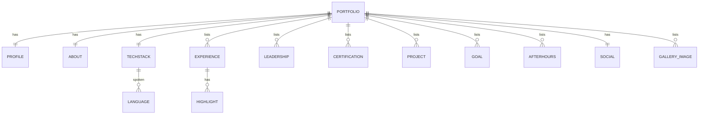

# Schema

This site has no database, so there are no tables, row-level security policies, or migrations. The schema is the shape of the `portfolioData` object in `src/data/portfolioData.js`. This document describes that shape instead.

## Data model (ERD)

There are no foreign keys. Each list is independent and is shown by one component.

## Entities

| Key | Shape | Used by |
|---|---|---|
| `profile` | `{ name, nickname, title, location, email, phone, resumeUrl, profileImage }` | Header, Contact, chatbot |
| `about` | `{ intro, experience, current }` (three paragraphs) | About |
| `techStack` | `{ frontend[], backend[], ai[], aiTools[], tools[], languages[] }` | TechStack, chatbot |
| `techStack.languages[]` | `{ name, level }` (spoken languages) | TechStack, chatbot |
| `experience[]` | `{ company, role, type, period, highlights[] }` | Experience, chatbot |
| `leadership[]` | `{ title, description, year }` | Leadership |
| `certifications[]` | `{ title, subtitle, url }` | Certifications |
| `projects[]` | `{ title, description, url, type }` | Projects, chatbot |
| `goals[]` | string | Goals, chatbot |
| `afterhours[]` | `{ title, description }` | Afterhours, chatbot |
| `social` | `{ linkedin, github, instagram, facebook, fiverr, onlinejobs }` (URLs) | Social |
| `gallery[]` | image path string | Gallery |

## Field rules

- `techStack` lists are arrays of plain strings, shown as chips in array order.
- `experience[].period` is free text, for example `"Mar 2026 - Aug 2026"`.
- `projects[].url` has no protocol. The component adds `https://`.
- `certifications[].url` is either a full URL or a path from `assetPath()` to a PDF in `public/assets/certificates/`.
- File paths for assets go through `assetPath()` and use lowercase names.
- Keep copy free of em dashes and emojis.

## Content changes (instead of migrations)

1. Edit `src/data/portfolioData.js`.
2. If you add a file, put it under `public/assets/` with a lowercase name.
3. Run `npm run build` to check that it compiles.
4. Commit and deploy.

If a new key is added to `portfolioData`, add a component or a field that reads it. If a key is renamed, search for its usages first. The chatbot in `src/utils/chatLogic.js` also reads `techStack`, `experience`, `projects`, `goals`, `afterhours`, and `profile`.

## If a backend is added later

A database would need real tables (the entities above map directly), migrations to version them, and row-level security if visitors can write data. Do not add one until a feature needs it, for example a contact form inbox or view analytics.
